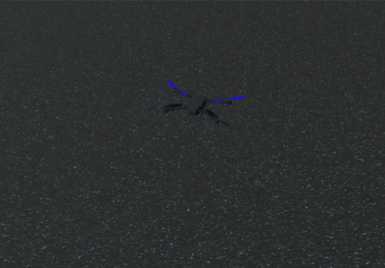

# ArduPilot SITL course

This course teaches you how to write software for a drone without needing a drone. You run
ArduPilot, the autopilot used on many real drones, on your own computer. Then you control it from
Python.

You learn by doing. Each exercise tells you what to build and how to approach it, gives you a
skeleton with `TODO`s, and tells you what you should see when it works. There are no answers in
this repo. If you get stuck, ask in the team channel.

<p align="center">
  <br>
  <em>Exercise 03 running in Webots (stage 2), sped up 2.5x</em>
</p>

## What you need to know

- Basic Python: variables, `if`, `for` and functions. The [Python tutorial](https://docs.python.org/3/tutorial/),
  sections 3 to 4, covers all of it.
- How to open a terminal and run a command.

You don't need to know anything about drones.

## How the course works

The course has two stages.

**Stage 1: ArduPilot SITL.** SITL means "software in the loop". It is the real autopilot code,
built to run on your computer. It comes with its own simple physics model, so you can fly with
nothing else installed. You use MAVProxy, a text-based ground station, to fly by hand first. Then
you write Python scripts with pymavlink.

**Stage 2: Webots.** Webots is a 3D robot simulator. You connect SITL to Webots, so the drone flies
in a 3D world with proper physics and sensors. Your scripts from stage 1 work without changes. Then
you use a depth camera to stop in front of a wall.

## Start here

1. Follow [docs/setup.md](docs/setup.md) to install everything. It tells you what to install on
   macOS, Linux and Windows, and which official pages to read.
2. Check your setup:
   ```bash
   python3 check_setup.py
   ```
   Every line should say `PASS`. If one says `FAIL`, it tells you which part of the setup guide to
   look at. The script only checks. It never installs or changes anything.
3. Read [stage1-sitl/README.md](stage1-sitl/README.md) and do exercises 01 to 05.
4. Read [stage2-webots/README.md](stage2-webots/README.md), run `python3 check_setup.py --webots`,
   and do exercises 06 and 07.

Before you write any Python, read [exercises/README.md](exercises/README.md). It explains every bit
of Python and pymavlink syntax the skeletons use.

## Exercises

| # | Exercise | Stage | You learn |
| --- | --- | --- | --- |
| 01 | [First flight](exercises/01-first-flight) | 1 | MAVProxy, flight modes, arming |
| 02 | [Take off and land from Python](exercises/02-takeoff-and-land) | 1 | connecting, sending commands, reading messages |
| 03 | [Fly a square mission](exercises/03-square-mission) | 1 | waypoints, `AUTO` mode, latitude and longitude |
| 04 | [Record and plot a flight](exercises/04-record-and-plot) | 1 | telemetry, CSV files, matplotlib |
| 05 | [Change a parameter](exercises/05-change-a-parameter) | 1 | parameters, measuring an effect |
| 06 | [Fly in Webots](exercises/06-fly-in-webots) | 2 | connecting SITL to Webots |
| 07 | [Stop before a wall](exercises/07-stop-before-a-wall) | 2 | reading a sensor and acting on it |

## What's in this repo

```
check_setup.py      checks your setup, installs nothing
requirements.txt    Python packages for the exercises
docs/setup.md       what to install and what to read
stage1-sitl/        how SITL and MAVProxy work
stage2-webots/      how Webots works, plus the world and parameter file for stage 2
exercises/          the Python guide and the seven exercises
```

## License

MIT. ArduPilot (GPLv3) and Webots (Apache 2.0) are not included. You download them yourself.
