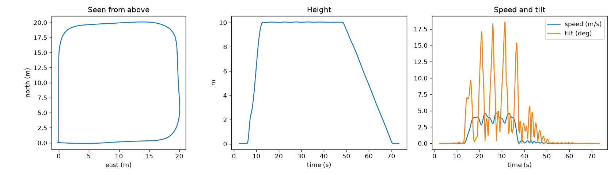

# 04 Record and plot a flight

**Goal:** record what the drone reports while it flies, save it to a CSV file, and draw three charts:
the path seen from above, the height over time, and the speed and tilt over time.



## What you need to know

**Telemetry** is the stream of messages the drone sends about itself. You've already read a few.
This exercise collects several kinds at once:

| Message | Fields you use | Meaning |
| --- | --- | --- |
| `LOCAL_POSITION_NED` | `x`, `y`, `z` | metres north, east and down from home |
| `VFR_HUD` | `groundspeed` | horizontal speed in m/s |
| `ATTITUDE` | `roll`, `pitch` | tilt in radians |
| `HEARTBEAT` | (through `drone.motors_armed()`) | is it flying? |

They arrive at different times and rates. So the recorder keeps a `sample` dictionary with the
latest value of each one. Each time a new position arrives, it saves a copy of `sample` as one row.

**Two scripts at once.** You want the recorder running while another script flies the drone. Only
one program can listen on a UDP port, so ask MAVProxy for a second copy of the messages on port
14551:

```bash
sim_vehicle.py --console --map --out 127.0.0.1:14551
```

**CSV** (comma-separated values) is a plain text table. Python's `csv` module writes it, and Excel or
Google Sheets can open it.

**matplotlib** draws charts. Read the [matplotlib quick start](https://matplotlib.org/stable/users/explain/quick_start.html)
up to "Coding styles". You only need `ax.plot()`, `ax.set_xlabel()`, `ax.set_title()` and
`ax.legend()`.

## Steps

1. Restart SITL with the extra `--out 127.0.0.1:14551` shown above.
2. In [starter.py](starter.py), fill in the `TODO`s in `record()`. Each `elif` stores one value in
   `sample`.
3. Run the recorder in one terminal:
   ```bash
   python3 exercises/04-record-and-plot/starter.py
   ```
4. In another terminal, fly something: your exercise 03 script, or exercise 02. The recorder stops
   by itself when the drone lands. You can also press `Ctrl+C`.
5. Open `flight.csv` and look at the numbers. Do they make sense?
6. Fill in the `TODO`s in `plot()`, and run the recorder and a flight again. Open `flight.png`.

## Hints

- Remember `z` points down. Store `up = -msg.z`.
- `math.degrees()` turns radians into degrees. For one "tilt" number, take the bigger of
  `abs(roll)` and `abs(pitch)`.
- `dict(sample)` makes a copy. If you append `sample` itself, every row ends up the same, because
  they're all the same dictionary.
- For the path from above, plot east on the x axis and north on the y axis, like a map. Then
  `ax.set_aspect("equal")` keeps the square square.
- If the recorder never stops, check that `HEARTBEAT` is in the list of types you read.

## What you should see

```
Recording. Fly the drone. Recording stops when it lands (or press Ctrl+C).
Saved 412 samples to flight.csv
Saved plot to flight.png
```

For the square mission, `flight.png` should look like the picture above: a square seen from above,
height rising to 10 m, staying flat and coming back down, and the speed rising and falling on each
side of the square.

## Questions to think about

1. Why does the speed drop at every corner?
2. When the speed goes up, what happens to the tilt? Why does a multicopter have to tilt to speed
   up?
3. About how many position messages arrive each second? (Hint: number of rows ÷ flight time.)

## Try next

- Add the battery voltage from `SYS_STATUS` (field `voltage_battery`, in millivolts) as a fourth
  chart.
- Plot the path in 3D with `fig.add_subplot(projection="3d")`.
