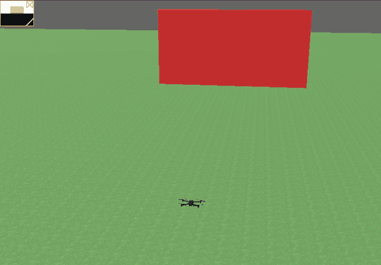

# 07 Stop before a wall

**Goal:** use a sensor to make a decision. The drone flies forward towards a wall, watches it with a
depth camera, and stops before it gets too close.



## What you need to know

**The world.** [obstacle.wbt](../../stage2-webots/worlds/obstacle.wbt) is a copy of `iris.wbt` with a
red wall 15 m in front of the drone. It also puts a `RangeFinder` on the drone's nose, using the
`extensionSlot`. Open the file and find both.

**The depth camera.** A Webots `RangeFinder` is a depth camera. Instead of colours, each pixel holds a
distance. This one is 64 × 48 pixels and sees up to 20 m.

**Getting the images.** The world's `controllerArgs` tell ArduPilot's controller to stream the depth
images on TCP port 5599. Each image is:

- 4 bytes: width and height, as two 16-bit numbers.
- Then one byte per pixel, row by row. 0 means 0 m and 255 means 20 m (the maximum range).

The skeleton already reads this for you, and turns it into a numpy array of distances in metres:
`image[row, column]`.

**numpy** is a library for arrays of numbers. You need two things:

- Slicing: `image[16:32, 21:43]` takes rows 16 to 31 and columns 21 to 42. The end number is not
  included.
- `np.median(part)` gives the middle value. The median ignores a few odd pixels, which an average
  doesn't.

**A background thread.** The image reader runs in a thread, so it keeps updating
`latest["distance"]` while the main code flies the drone. You don't need to change that part.

**Flying with a velocity.** `mydrone.move_forward(drone, speed)` asks for a speed instead of a
position. Copter stops if it gets no new velocity for a few seconds, so you send it again and again
in a loop.

## Steps

1. Copy the world into ArduPilot's worlds folder, so it can find the Iris PROTO and the controller:
   ```bash
   cp stage2-webots/worlds/obstacle.wbt ~/ardupilot/libraries/SITL/examples/Webots_Python/worlds/
   ```
2. Open that copy in Webots (**File > Open World**), then start SITL as in exercise 06.
3. In [starter.py](starter.py), fill in the two `TODO`s:
   - In `read_depth_camera()`, take the middle third of the image (rows and columns) and store its
     median in `latest["distance"]`.
   - Change the `while` loop so it only keeps flying while the wall is farther than
     `STOP_DISTANCE`.
4. Run it:
   ```bash
   python3 exercises/07-stop-before-a-wall/starter.py
   ```

## Hints

- The image has `height` rows and `width` columns. The middle third of the rows goes from
  `height // 3` to `2 * height // 3`. `//` divides and rounds down, so you get whole numbers for
  slicing.
- Print `latest["distance"]` in the loop. The skeleton already does this. Check it starts near 15 m
  and goes down as you fly.
- If the distance is always 20, the camera sees nothing: are you looking at the right part of the
  image?
- If the script hangs before take-off, it can't connect to port 5599. Check you opened
  `obstacle.wbt`, not `iris.wbt`.

## What you should see

```
Flying forward
  wall ahead: 14.6 m
  wall ahead: 14.3 m
  ...
  wall ahead:  5.3 m
Wall at 4.9 m. Stopping.
Holding at 2.8 m from the wall
Landed and disarmed
```

The drone takes off to 2 m, flies at 1.5 m/s, stops in front of the wall and lands. It ends up about
2 m closer than where it decided to stop.

## Questions to think about

1. Why does the drone end up closer to the wall than `STOP_DISTANCE`? Name two reasons.
2. If you fly at 4 m/s instead, should `STOP_DISTANCE` be bigger or smaller? Try it.
3. Why use the median of the middle of the image, not the smallest pixel in the whole image?

## Try next

- Slow down smoothly as the wall gets closer, instead of stopping all at once. For example, make
  the speed proportional to the distance left.
- Fly around the wall instead of stopping. You'll need a velocity with a sideways part. Look at how
  `move_forward()` builds its message.
